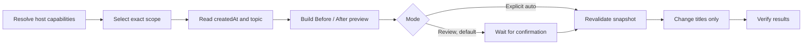

# Agent Title Renamer — Codex & Claude Code Skill

**English (default)** | [简体中文](README.zh-CN.md)

[](https://agentskills.io)
[](https://openai.com/codex/)
[](skills/agent-title-renamer/references/claude-code-adapter.md)
[](LICENSE)
[](https://github.com/BrownieCoder/agent-title-renamer-skill/stargazers)

Batch-preview and safely rename messy Codex tasks and local Claude Code sessions.

`MMDD｜TYPE｜Topic` · 11 types · Preview first · Revalidate before write · Never rename projects

One portable naming policy for Codex, Claude Code, and other Agent Skills-compatible tools, now with an optional official-SDK bridge for Claude Code local history.

> Automatic history access still depends on each host. The Claude adapter covers locally persisted Claude Code sessions—not Claude.ai, web, mobile, or another computer's history. See [Compatibility](#compatibility).

[See the 10-title example](#example) · [Quick install](#install) · [Claude batch adapter](#claude-code-batch-adapter-beta) · [Automation](docs/automation.md)

## Example

Default format: `MMDD｜TYPE｜Topic`

Here is a complete ten-item preview.

| Before | After |
| --- | --- |
| Fix image upload crash | 0818｜FIX｜Image upload crash |
| Speed up search indexing | 0820｜OPT｜Search indexing |
| Add bulk export | 0822｜FEA｜Bulk export |
| Document API auth | 0824｜DOC｜API authentication |
| Prepare v1.2 release | 0828｜REL｜v1.2 release |
| Research vector database options | 0830｜RES｜Vector database options |
| Design UI alignment | 0901｜DES｜UI alignment plan |
| Review the login patch | 0902｜REV｜Login patch review |
| Reproduce the upload timeout | 0903｜TST｜Upload timeout reproduction |
| Set up the local model | 0904｜CFG｜Local model setup |

If everything looks right, reply `Confirm` in the same conversation.

| Before | After | Result |
| --- | --- | --- |
| Fix image upload crash | 0818｜FIX｜Image upload crash | Renamed |
| Research vector database options | 0830｜RES｜Vector database options | Renamed |
| Set up the local model | 0904｜CFG｜Local model setup | Renamed |

Prefer Chinese labels? Invoke the skill in Chinese:

| Before | After |
| --- | --- |
| 优化批次文字显示 | 0903｜优化｜批次文字显示 |
| 修复超时后的登录跳转 | 0902｜修复｜登录跳转 |
| 研究向量数据库选型 | 0830｜研究｜向量数据库选型 |

Each run uses one TYPE language. It never mixes `OPT` and `优化` in the same preview.

## Claude Code batch adapter (Beta)

This release includes a working bridge to Anthropic's documented Python Agent SDK. The skill decides the title; the adapter handles only session access and guarded mutation.

| Stage | What happens |
| --- | --- |
| Inventory | `list_sessions` resolves one exact project directory. Cross-project discovery stays read-only. |
| Evidence | `get_session_messages` supplies bounded human text and a complete evidence fingerprint. |
| Preview | Zero rename calls. The adapter validates `created_at`, TYPE language, and scope, then seals a private plan with a SHA-256 digest. |
| Apply | The digest, metadata, current title, and message evidence are rechecked before `rename_session`; an exact-directory re-read verifies `custom_title`. |

The adapter never parses or edits Claude's internal JSONL files. The active housekeeping session is excluded automatically when Claude exposes `CLAUDE_CODE_SESSION_ID`. While the upstream metadata window remains limited, mutation also fails closed for sessions larger than 128 KiB.

```text
Preview generated → 10 proposed titles → 0 writes
Reply `Confirm` → revalidate the sealed preview → rename → verify
Any drift detected → skip that session
```

See the [Claude adapter guide](skills/agent-title-renamer/references/claude-code-adapter.md) for commands and the Beta boundary.

## Why it is useful

- **Find old work faster.** Dates, intent, and topic are visible in the sidebar.
- **Preview before changing anything.** Review mode is the default.
- **Use it across agents.** The skill follows the open `SKILL.md` format.
- **Stay in control.** Automatic mode exists only when you explicitly request it.
- **No storage hacks.** The skill never directly edits undocumented internal databases or transcript files.

## Compatibility

The Agent Skills standard defines how instructions are packaged. It does not define a universal conversation API.

| Host / setup | List and read | Batch rename | Coverage |
| --- | --- | --- | --- |
| Codex with task-management tools | Yes | Yes | Accessible Codex tasks in the exact requested scope. |
| Claude Code + bundled SDK adapter | SDK-visible sessions | Selected IDs, **Beta** | One exact project directory per run; cross-project/worktree discovery is read-only, and oversized sessions fail closed. |
| Claude Code, skill only | Active session | Native `/rename` only | Current session; no history-wide claim. |
| Claude.ai, web, mobile, or another computer | No | No | These histories are not accessed by the local adapter. |
| Other Agent Skills clients | Host-dependent | Host-dependent | Naming policy is portable; mutations require documented host title tools. |

## Install

### Codex

Ask Codex:

```text
$skill-installer Install the skill from https://github.com/BrownieCoder/agent-title-renamer-skill/tree/main/skills/agent-title-renamer
```

Then invoke it explicitly:

```text
$agent-title-renamer Preview standardized titles for conversations in the current project.
```

### Claude Code

Clone the repository, then copy `skills/agent-title-renamer` to either:

```text
~/.claude/skills/agent-title-renamer          # personal
.claude/skills/agent-title-renamer            # project-local
```

Invoke it with:

```text
/agent-title-renamer Preview standardized titles for local sessions in this project.
```

For guarded batch access to local session history, set up the optional SDK dependency inside the installed skill directory:

```bash
cd ~/.claude/skills/agent-title-renamer
python3 -m venv .venv
.venv/bin/python -m pip install -r requirements-claude.txt
.venv/bin/python scripts/claude_adapter.py doctor
```

On Windows, replace `.venv/bin/python` with `.venv\Scripts\python.exe`. The dependency is never installed automatically.

With the adapter available, the skill can preview and safely batch-rename selected, SDK-visible local Claude Code sessions within its Beta limits. Without it, the skill falls back to suggestions and Claude Code's native `/rename <title>` for the active session. It never directly edits internal JSONL files.

If the host does not expose a reliable session creation timestamp, the skill will not invent the `MMDD` prefix; it will keep the title unchanged or provide undated naming guidance only.

### Other compatible agents

Copy the `skills/agent-title-renamer` directory into that host's Agent Skills directory. Installation paths and invocation syntax vary by product.

Installing the skill only makes it available. It does not scan conversations, rename anything, or create an automation by itself.

The repository and display name include **Skill** for clarity and discovery. The invocation stays shorter: `agent-title-renamer`.

### Upgrading from the Codex-only version

Install `agent-title-renamer`, update saved prompts from `$codex-task-title-renamer` to `$agent-title-renamer`, and test one preview before removing the old skill folder. Repository redirects do not translate skill invocation names.

## How it works



The skill selects the workflow supported by the host:

1. **Full workflow:** the host can list, read, and rename title-bearing items.
2. **Current-item workflow:** the host exposes only the active conversation.
3. **Preview-only workflow:** the host cannot mutate titles; the skill provides exact suggestions or native commands without claiming a rename occurred.

## Naming rules

- Date comes only from `createdAt`, never `updatedAt`.
- An explicit title timezone wins. Otherwise the automation timezone, then the host's configured local timezone, is used.
- Topic uses the conversation’s main language and describes its actual goal or substantial outcome, without repeating its project or workspace name. TYPE language is chosen once per run.
- Keep accurate, compliant titles; routine follow-ups do not trigger renaming.
- Skip sensitive details in sidebar titles.
- For legacy items with missing project metadata, use concrete repository, artifact, or migration evidence tied to one accessible project. A similar name or working directory alone is insufficient; uncertain items stay unchanged, and project membership is never repaired.
- Unclear topics keep their original titles. The skill does not guess.
- Titles stay short enough to scan in a sidebar.
- Only title-specific mutation is allowed. Content, assignment, order, pin state, and archive state remain untouched.

| Code | Chinese | Meaning |
| --- | --- | --- |
| FEA | 功能 | Feature |
| DES | 设计 | Design or implementation plan |
| FIX | 修复 | Bug fix |
| OPT | 优化 | Optimization |
| REL | 发布 | Release |
| EXP | 探索 | Exploration |
| DOC | 文档 | Documentation |
| RES | 研究 | Research |
| REV | 评审 | Independent review |
| TST | 测试 | Dedicated validation or reproduction |
| CFG | 配置 | Environment, installation, or tool setup |

Tests and reviews that accompany implementation keep the feature or fix TYPE. Use `REV` when review itself is the deliverable, `TST` for dedicated verification, and `CFG` for setup.

## Review or automatic mode

Review mode is the default: preview first, then confirm that exact snapshot.

Automatic mode is opt-in. Say `automatic`, `unattended`, or `without confirmation` in the request or saved automation prompt. Permission follows the scope and duration you explicitly authorize. One automatic run does not enable future runs; a saved automation prompt or an explicitly approved standing rule can authorize its stated recurring scope.

For recurring housekeeping, see the [automation guide](docs/automation.md). It includes review and explicit automatic templates, with a user-selected schedule and timezone.

### Name new conversations from their first turn

If you want new conversations named as work begins, explicitly enable the current-conversation rule in your host instructions. It uses the same 11 types and verified creation date, and changes only the current user-owned title. Installing the skill does not enable it. See the [first-turn setup example](docs/automation.md#name-new-conversations-during-the-first-turn).

## Design boundary

This is a title-governance skill, not a database migration tool. It uses documented host capabilities only. If a host cannot provide a stable item identifier, a reliable `createdAt`, a complete requested scope, or a title-only mutation, the skill stops or falls back to preview-only mode.

The host capability contract is documented in [`references/host-contract.md`](skills/agent-title-renamer/references/host-contract.md).

## Documentation and sources

- [Automation guide](docs/automation.md)
- [Acceptance scenarios](tests/acceptance.md)
- [Agent Skills specification](https://agentskills.io/specification)
- [Claude Code skills](https://code.claude.com/docs/en/slash-commands) and [session naming](https://code.claude.com/docs/en/sessions)
- [Claude Agent SDK session APIs](https://code.claude.com/docs/en/agent-sdk/python)
- [Codex App Server](https://learn.chatgpt.com/docs/app-server)

## Support the project

If cleaner conversation history saves you time, [star the repository](https://github.com/BrownieCoder/agent-title-renamer-skill) so more agent users can find it. Found an edge case or want to contribute a host adapter? [Open an issue](https://github.com/BrownieCoder/agent-title-renamer-skill/issues).

## License

[MIT](LICENSE)

This is an independent community project. It is not an official OpenAI or Anthropic product.
