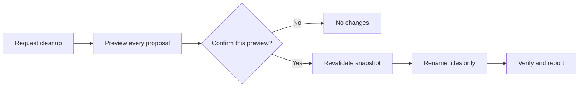

# Codex Task Title Renamer

**English** | [简体中文](README.zh-CN.md)

[](https://github.com/BrownieCoder/codex-task-title-renamer/stargazers)
[](LICENSE)


Turn a messy Codex sidebar into a clean, easy-to-scan task history.

This skill previews every proposed rename, waits for your confirmation, and changes task titles only—never the project name.

```text
MMDD｜TYPE｜Topic
```

[Quick start](#quick-start) · [See the 10-title demo](#see-the-difference) · [Daily scheduling](docs/scheduler.md)

## Quick start

1. Ask Codex to install the skill:

   ```text
   $skill-installer Install the skill from https://github.com/BrownieCoder/codex-task-title-renamer/tree/main/skills/codex-task-title-renamer
   ```

2. Request a preview for the current project:

   ```text
   $codex-task-title-renamer Preview standardized titles for tasks in the current Codex project.
   ```

3. If the full preview looks right, reply `Confirm` in the same task.

Installation only makes the skill available. It does not scan tasks, create an automation, or rename anything by itself.

For repository-scoped use, place the skill folder at:

```text
.agents/skills/codex-task-title-renamer
```

## See the difference

Codex previews every eligible proposal from oldest to newest by `createdAt`. At this point, nothing has been renamed.

| Before | After |
|---|---|
| Update API setup guide | 0818｜DOC｜API setup guide |
| Add CSV export for reports | 0820｜FEA｜CSV report export |
| Review dashboard layout options | 0822｜DES｜Dashboard layout |
| Explore offline sync feasibility | 0824｜EXP｜Offline sync |
| Reduce image loading time | 0826｜OPT｜Image loading |
| Push the v1.2 release to GitHub | 0828｜REL｜v1.2 |
| Research vector database options | 0830｜RES｜Vector database options |
| Add keyboard shortcuts | 0901｜FEA｜Keyboard shortcuts |
| Fix login redirect after timeout | 0902｜FIX｜Login redirect |
| Improve batch text display | 0903｜OPT｜Batch text display |

If the full preview looks right, reply `Confirm` in the same task. Codex then revalidates the approved snapshot, renames titles only, and verifies each result.

<details>
<summary><strong>Verified result for all 10 demo tasks</strong></summary>

| Before | After | Result |
|---|---|---|
| Update API setup guide | 0818｜DOC｜API setup guide | Renamed |
| Add CSV export for reports | 0820｜FEA｜CSV report export | Renamed |
| Review dashboard layout options | 0822｜DES｜Dashboard layout | Renamed |
| Explore offline sync feasibility | 0824｜EXP｜Offline sync | Renamed |
| Reduce image loading time | 0826｜OPT｜Image loading | Renamed |
| Push the v1.2 release to GitHub | 0828｜REL｜v1.2 | Renamed |
| Research vector database options | 0830｜RES｜Vector database options | Renamed |
| Add keyboard shortcuts | 0901｜FEA｜Keyboard shortcuts | Renamed |
| Fix login redirect after timeout | 0902｜FIX｜Login redirect | Renamed |
| Improve batch text display | 0903｜OPT｜Batch text display | Renamed |

</details>

An unclear task such as `Quick chat` keeps its original title and does not appear in the preview. These 10 rows are the demo size, not a limit: a real preview includes every eligible proposed change.

## How it works



### Run it when you need it

| Mode | What happens |
|---|---|
| Explicit | Mention `$codex-task-title-renamer` for the most reliable selection. |
| Implicit | Ask Codex to organize, normalize, or batch-rename project task titles; Codex may select the skill when the request matches. |
| No request | Nothing runs in the background and no title changes. |

Implicit selection is contextual and is not guaranteed for every phrasing. For recurring housekeeping, create a scheduled task that explicitly invokes the skill and generates a preview for manual confirmation. See the [daily scheduling guide](docs/scheduler.md).

## Safe by design

- The target project is matched by exact `projectId`.
- Dates come only from `createdAt`, converted to `Asia/Shanghai`.
- Uncertain classifications keep their original titles.
- Existing compliant titles are left unchanged.
- Approval is bound to one preview snapshot.
- Tasks that change after preview are skipped.
- Project name, task content, project assignment, order, pin state, and archive state are never changed.
- Inspected task content is treated as untrusted data, not as instructions.

## Naming scheme

```text
MMDD｜TYPE｜Topic
```

TYPE follows the invocation language: English requests use English codes, while Chinese requests use Chinese labels. An explicit language choice always wins, and English is the fallback when the request language is mixed or unclear. One run never mixes TYPE languages.

| Code | Chinese label | Meaning |
|---|---|---|
| `FEA` | `功能` | Feature |
| `DES` | `设计` | Design |
| `FIX` | `修复` | Bug fix |
| `OPT` | `优化` | Optimization |
| `REL` | `发布` | Release |
| `EXP` | `探索` | Exploration |
| `DOC` | `文档` | Documentation |
| `RES` | `研究` | Research |

Examples:

```text
Improve batch text display  →  0903｜OPT｜Batch text display
New feature discussion      →  0901｜DES｜UI alignment check
优化批次文字显示              →  0903｜优化｜批次文字显示
```

## Requirements

- A Codex host that can list, read, and rename tasks.
- Access to each task's `createdAt` metadata.

No external service or script is required.

## Documentation

- [Daily scheduling guide](docs/scheduler.md)
- [Acceptance tests](tests/acceptance.md)
- OpenAI's [Build skills](https://learn.chatgpt.com/docs/build-skills) documentation for the current Codex skill format and installation model

## Support the project

If this skill makes your Codex projects easier to navigate, consider starring the repository so more people can find it. Found an edge case? [Open an issue](https://github.com/BrownieCoder/codex-task-title-renamer/issues).

## License

[MIT](LICENSE)

This is an independent community project and is not an official OpenAI product.
