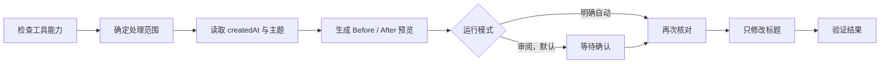

# Agent Title Renamer — Codex 与 Claude Code Skill

[English (default)](README.md) | **简体中文**

[](https://agentskills.io)
[](https://openai.com/codex/)
[](skills/agent-title-renamer/references/claude-code-adapter.md)
[](LICENSE)
[](https://github.com/BrownieCoder/agent-title-renamer-skill/stargazers)

把 Codex 任务和 Claude Code 会话统一成一套标题格式。

`MMDD｜TYPE｜Topic` · 11 类标签 · 先预览，再修改 · 只改标题，不改项目名

同一套规则可用于 Codex、Claude Code 和其他兼容 Agent Skills 的工具。Claude Code 的本地批量改名由官方 SDK 适配器提供，目前是 Beta。

> 不同工具开放的会话权限不同。Claude 适配器只处理保存在本机的 Claude Code 会话，不包括 Claude.ai、网页版、移动端或其他电脑上的历史。具体见[兼容性](#兼容性)。

[查看 10 个例子](#例子) · [安装](#安装) · [Claude 批量适配器](#claude-code-批量适配器beta) · [自动化](docs/automation.zh-CN.md)

## 例子

默认格式：`MMDD｜TYPE｜Topic`

下面是一份完整的 10 条预览。

| Before | After |
| --- | --- |
| 修复图片上传崩溃 | 0818｜修复｜图片上传崩溃 |
| 加快搜索索引 | 0820｜优化｜搜索索引 |
| 增加批量导出 | 0822｜功能｜批量导出 |
| 编写 API 鉴权文档 | 0824｜文档｜API 鉴权 |
| 准备 v1.2 发布 | 0828｜发布｜v1.2 发布 |
| 研究向量数据库选型 | 0830｜研究｜向量数据库选型 |
| 设计界面对齐方案 | 0901｜设计｜界面对齐方案 |
| 评审登录补丁 | 0902｜评审｜登录补丁评审 |
| 复现上传超时 | 0903｜测试｜上传超时复现 |
| 配置本地模型 | 0904｜配置｜本地模型配置 |

预览无误后，在同一个任务中回复「确认」即可。

| Before | After | Result |
| --- | --- | --- |
| 修复图片上传崩溃 | 0818｜修复｜图片上传崩溃 | 已重命名 |
| 研究向量数据库选型 | 0830｜研究｜向量数据库选型 | 已重命名 |
| 配置本地模型 | 0904｜配置｜本地模型配置 | 已重命名 |

如果用英文调用，TYPE 会统一使用英文代码：

| Before | After |
| --- | --- |
| Improve batch text display | 0903｜OPT｜Batch text display |
| Fix timeout login redirect | 0902｜FIX｜Login redirect |
| Research vector database options | 0830｜RES｜Vector database options |

同一次改名只使用一种 TYPE 语言，不会把 `OPT` 和 `优化` 混在一张表里。

## Claude Code 批量适配器（Beta）

这一版接入了 Anthropic 官方 Python Agent SDK。Skill 负责判断标题，适配器负责读取和改名，并在写入前后检查结果。

| 阶段 | 做什么 |
| --- | --- |
| 读取 | 用 `list_sessions` 读取一个项目目录；跨项目只能查看，不能直接批量改名。 |
| 取样 | 用 `get_session_messages` 提取判断主题所需的少量文字，并记录消息指纹。 |
| 预览 | 只生成候选标题，不执行改名；同时检查 `created_at`、TYPE 语言和处理范围。 |
| 改名 | 再次核对标题和消息，调用 `rename_session`，然后重新读取会话确认结果。 |

适配器不直接读写 Claude 内部的 JSONL 文件。运行整理任务的当前会话会默认排除；超过 128 KiB 的长会话暂不改名。

```text
生成预览 → 10 个候选标题 → 0 次修改
回复「确认」→ 再次核对 → 改名 → 检查结果
内容有变化 → 跳过这一条
```

详细命令和当前限制见 [Claude 适配器指南](skills/agent-title-renamer/references/claude-code-adapter.md)。

## 特点

- 标题包含日期、类型和主题，方便在侧边栏查找旧会话。
- 默认先显示完整预览，确认后再改名。
- 使用开放的 `SKILL.md` 格式，可以在多种 Agent 工具中使用。
- 自动模式需要明确开启。
- 只使用工具公开的改名能力，不直接修改内部存储。

## 兼容性

Agent Skills 规定了 Skill 的打包方式，但没有提供通用的会话管理 API。

| 宿主 / 配置 | 列出并读取 | 批量改名 | 覆盖范围 |
| --- | --- | --- | --- |
| 提供任务管理工具的 Codex | 可以 | 可以 | 指定范围内能访问到的 Codex 任务。 |
| Claude Code + SDK 适配器 | SDK 可见会话 | 选中的会话 ID，**Beta** | 一次处理一个项目目录；跨项目/worktree 只能查看，超过 128 KiB 的会话会跳过。 |
| 仅安装 Skill 的 Claude Code | 当前会话 | 仅原生 `/rename` | 只处理当前会话，不批量修改历史。 |
| Claude.ai、网页、移动端或另一台电脑 | 不可以 | 不可以 | 本地适配器不会访问这些历史。 |
| 其他 Agent Skills 客户端 | 取决于宿主 | 取决于宿主 | 命名规则可移植；执行需要宿主提供公开的标题工具。 |

## 安装

### Codex

告诉 Codex：

```text
$skill-installer 从 https://github.com/BrownieCoder/agent-title-renamer-skill/tree/main/skills/agent-title-renamer 安装这个 Skill。
```

然后显式调用：

```text
$agent-title-renamer 预览当前项目中会话的规范化标题。
```

### Claude Code

克隆仓库，然后把 `skills/agent-title-renamer` 复制到以下任一位置：

```text
~/.claude/skills/agent-title-renamer          # 个人级
.claude/skills/agent-title-renamer            # 项目级
```

调用方式：

```text
/agent-title-renamer 预览当前项目中本地会话的规范化标题。
```

如需批量处理本地会话，再到已经安装的 Skill 目录中配置官方 SDK 依赖：

```bash
cd ~/.claude/skills/agent-title-renamer
python3 -m venv .venv
.venv/bin/python -m pip install -r requirements-claude.txt
.venv/bin/python scripts/claude_adapter.py doctor
```

Windows 请把 `.venv/bin/python` 替换为 `.venv\Scripts\python.exe`。依赖不会被自动安装。

安装适配器后，可以批量处理同一项目目录中明确选中的本地会话。目前该功能仍是 Beta。没有适配器时，Skill 只生成标题建议，当前会话可用 Claude Code 原生的 `/rename <标题>` 修改。

如果工具没有提供可靠的会话创建时间，Skill 会保留原标题，或只给出不带日期的建议，不会猜一个 `MMDD`。

### 其他兼容 Agent Skills 工具

把 `skills/agent-title-renamer` 目录复制到该宿主的 Agent Skills 目录。不同产品的安装路径和调用语法可能不同。

安装只让 Skill 可用；请求匹配时才会调用。它不会仅因安装就扫描会话、修改标题或创建自动化。

`Skill` 保留在仓库名中，调用名为 `agent-title-renamer`。

### 从 Codex 专用版升级

先安装 `agent-title-renamer`，把保存提示词中的 `$codex-task-title-renamer` 改为 `$agent-title-renamer`，完成一次预览测试后再移除旧 Skill 目录。GitHub 仓库重定向不会自动转换 Skill 调用名。

## 怎么工作



Skill 会根据当前工具提供的能力选择流程：

1. **完整流程：** 可以列出、读取和修改一组会话标题。
2. **当前会话：** 只能处理正在使用的会话。
3. **仅预览：** 不能直接改名时，只给出建议或可执行的原生命令。

## 命名规则

- 日期只取 `createdAt`，不使用 `updatedAt`。
- 用户指定的标题时区优先；否则依次使用自动化时区和工具配置的本地时区。
- Topic 使用会话的主要语言，概括主要目标或实际成果，不重复项目或工作区名称；TYPE 语言按整次运行统一。
- 已经合规且准确的标题保持不变，普通追问不会触发改名。
- 标题不包含凭据、敏感个人信息或私有标识。
- 旧任务缺少项目元数据时，依据仓库链接、产物路径或迁移记录核实项目；不只凭相似名称或工作目录判断。证据不足时保留原标题，不修改项目归属。
- 无法判断主题时保留原标题，不猜测。
- 标题保持简短，适合在侧边栏快速浏览。
- 只修改标题；内容、归属、顺序、置顶和归档状态全部保持不变。

| 英文代码 | 中文标签 | 含义 |
| --- | --- | --- |
| FEA | 功能 | 新增功能 |
| DES | 设计 | 设计或实施计划 |
| FIX | 修复 | 修复缺陷 |
| OPT | 优化 | 优化已有行为 |
| REL | 发布 | 发布或部署 |
| EXP | 探索 | 开放式探索 |
| DOC | 文档 | 文档或使用说明 |
| RES | 研究 | 资料调研与比较 |
| REV | 评审 | 独立审查已有方案或代码 |
| TST | 测试 | 以验证或复现为主要目标 |
| CFG | 配置 | 环境、安装或工具设置 |

开发功能时附带的测试和评审，仍归类为「功能」或「修复」；只有独立审查、专门验证和环境设置，才使用新增的三类。

## 预览与自动模式

默认先预览，确认后再修改。

自动模式必须明确开启。请在请求或自动化提示词中写明「自动执行」「无人值守」或「无需确认」。授权按你明确指定的范围和期限生效。单次自动执行不会变成长期设置；保存的自动化提示词或你主动批准的长期规则，可以授权相应的后续运行。

需要定期整理时，请参阅[自动化教程](docs/automation.zh-CN.md)。其中有预览和自动两种模板，运行时间与时区由你自己设置。

### 新会话从第一轮开始命名

如果希望开始处理请求时就整理标题，可以主动把当前会话规则加入宿主指令。它使用相同的 11 类标签和真实创建时间，只修改当前用户会话的标题。安装 Skill 本身不会启用。具体见[首轮命名配置示例](docs/automation.zh-CN.md#新会话首轮命名)。

## 限制

这个 Skill 只整理会话标题，不处理数据库。如果当前工具不能可靠提供会话 ID、`createdAt`、完整列表，或单独修改标题，Skill 只生成预览，不会执行改名。

各工具需要提供哪些能力，见 [`references/host-contract.md`](skills/agent-title-renamer/references/host-contract.md)。

## 相关文档

- [自动化教程](docs/automation.zh-CN.md)
- [验收场景](tests/acceptance.md)
- [Agent Skills 规范](https://agentskills.io/specification)
- [Claude Code Skills](https://code.claude.com/docs/en/slash-commands) 与[会话命名](https://code.claude.com/docs/en/sessions)
- [Claude Agent SDK 会话 API](https://code.claude.com/docs/en/agent-sdk/python)
- [Codex App Server](https://learn.chatgpt.com/docs/app-server)

## 支持项目

觉得这个 Skill 有用，欢迎给[仓库点一个 Star](https://github.com/BrownieCoder/agent-title-renamer-skill)。遇到问题或想增加新的工具适配器，可以[提交 Issue](https://github.com/BrownieCoder/agent-title-renamer-skill/issues)。

## License

[MIT](LICENSE)

这是一个独立的社区项目，并非 OpenAI 或 Anthropic 官方产品。
