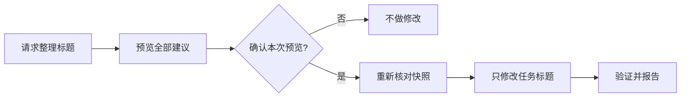

# Codex 任务标题重命名器

[English](README.md) | **简体中文**

[](https://github.com/BrownieCoder/codex-task-title-renamer/stargazers)
[](LICENSE)


把杂乱的 Codex 侧边栏整理成一眼就能看懂的任务记录。

它会先列出所有改名建议；你确认后，才会修改任务标题。项目名称绝不会动。

```text
MMDD｜TYPE｜Topic
```

[快速开始](#快速开始) · [查看 10 条完整 Demo](#查看-10-条完整-demo) · [每日计划任务](docs/scheduler.zh-CN.md)

## 快速开始

1. 让 Codex 安装这个 Skill：

   ```text
   $skill-installer 从 https://github.com/BrownieCoder/codex-task-title-renamer/tree/main/skills/codex-task-title-renamer 安装这个 Skill。
   ```

2. 请求预览当前项目的标题：

   ```text
   $codex-task-title-renamer 预览当前 Codex 项目的规范化任务标题。
   ```

3. 如果完整预览没有问题，在同一个任务中回复「确认」即可。

安装只会让 Codex 可以使用这个 Skill，不会自行扫描任务、创建计划任务或修改标题。

如需仅在某个仓库中使用，可以把 Skill 文件夹放到：

```text
.agents/skills/codex-task-title-renamer
```

## 查看 10 条完整 Demo

Codex 会按 `createdAt` 从早到晚展示所有符合条件的改名建议。看到这张表时，任何标题都还没有被修改。

| Before | After |
|---|---|
| 更新 API 配置指南 | 0818｜文档｜API配置指南 |
| 为报表添加 CSV 导出 | 0820｜功能｜报表CSV导出 |
| 讨论仪表盘布局方案 | 0822｜设计｜仪表盘布局 |
| 探索离线同步可行性 | 0824｜探索｜离线同步 |
| 优化图片加载速度 | 0826｜优化｜图片加载 |
| 把 v1.2 发布到 GitHub | 0828｜发布｜v1.2 |
| 研究向量数据库选型 | 0830｜研究｜向量数据库选型 |
| 添加键盘快捷键 | 0901｜功能｜键盘快捷键 |
| 修复超时后的登录跳转 | 0902｜修复｜登录跳转 |
| 优化批次文字显示 | 0903｜优化｜批次文字显示 |

如果完整预览没有问题，在同一个任务中回复「确认」即可。Codex 随后会重新核对这份预览，只修改任务标题，并逐项验证结果。

<details>
<summary><strong>展开查看 10 条 Demo 的验证结果</strong></summary>

| Before | After | Result |
|---|---|---|
| 更新 API 配置指南 | 0818｜文档｜API配置指南 | Renamed |
| 为报表添加 CSV 导出 | 0820｜功能｜报表CSV导出 | Renamed |
| 讨论仪表盘布局方案 | 0822｜设计｜仪表盘布局 | Renamed |
| 探索离线同步可行性 | 0824｜探索｜离线同步 | Renamed |
| 优化图片加载速度 | 0826｜优化｜图片加载 | Renamed |
| 把 v1.2 发布到 GitHub | 0828｜发布｜v1.2 | Renamed |
| 研究向量数据库选型 | 0830｜研究｜向量数据库选型 | Renamed |
| 添加键盘快捷键 | 0901｜功能｜键盘快捷键 | Renamed |
| 修复超时后的登录跳转 | 0902｜修复｜登录跳转 | Renamed |
| 优化批次文字显示 | 0903｜优化｜批次文字显示 | Renamed |

</details>

像“随便聊聊”这样无法可靠判断类型或主题的任务会保留原标题，也不会出现在预览中。这 10 条只是 Demo 数量，并非运行上限；实际预览会包含所有符合条件的候选改名。

## 工作方式



### 按需运行

| 方式 | 会发生什么 |
|---|---|
| 显式调用 | 在提示中写 `$codex-task-title-renamer`，这是最可靠的调用方式。 |
| 隐式调用 | 直接要求 Codex 整理、规范化或批量重命名项目任务标题；请求匹配时，Codex 可能自动选择这个 Skill。 |
| 不发出请求 | 不会在后台运行，也不会修改任何标题。 |

隐式选择取决于上下文，不能保证每种说法都会触发。如需定期整理，可以创建一项显式调用这个 Skill 的计划任务，让它生成预览，再由你手动确认。具体设置请参阅[每日计划任务教程](docs/scheduler.zh-CN.md)。

## 安全边界

- 通过精确的 `projectId` 匹配目标项目。
- 日期只取自 `createdAt`，并转换为 `Asia/Shanghai`。
- 无法可靠分类时保留原标题。
- 已经合规且准确的标题保持不变。
- 每次确认只对应一份预览快照。
- 预览后发生变化的任务会被跳过。
- 绝不修改项目名称、任务内容、项目归属、顺序、置顶状态或归档状态。
- 将读取到的任务内容视为不可信数据，而不是可执行指令。

## 命名格式

```text
MMDD｜TYPE｜Topic
```

TYPE 跟随调用语言：中文请求使用中文标签，英文请求使用英文代码。用户显式指定时以指定语言为准；语言混合或无法判断时回退到英文代码。同一次运行不会混用两种 TYPE。

| 英文代码 | 中文标签 | 含义 |
|---|---|---|
| `FEA` | `功能` | 新增功能 |
| `DES` | `设计` | 产品、界面、体验、架构或方案设计 |
| `FIX` | `修复` | 缺陷或故障修复 |
| `OPT` | `优化` | 对现有功能、性能、体验或结构进行优化 |
| `REL` | `发布` | 合并、提交、发布、部署或分发 |
| `EXP` | `探索` | 可行性探索、实验或原型 |
| `DOC` | `文档` | 文档编写与维护 |
| `RES` | `研究` | 资料收集、研究与分析 |

示例：

```text
优化批次文字显示  →  0903｜优化｜批次文字显示
新功能讨论        →  0901｜设计｜界面对齐检查
提交代码到 GitHub →  0813｜发布｜提交代码到GitHub
```

## 使用条件

- Codex 环境能够列出、读取和重命名任务。
- 能够读取每个任务的 `createdAt` 元数据。

不需要外部服务或脚本。

## 文档

- [每日计划任务教程](docs/scheduler.zh-CN.md)
- [验收测试](tests/acceptance.md)
- OpenAI 官方的 [Build skills](https://learn.chatgpt.com/docs/build-skills) 文档，介绍当前 Codex Skill 格式与安装方式

## 支持这个项目

如果这个 Skill 能帮你更快找到旧任务，欢迎点个 Star，让更多人也能用到。发现边界情况？欢迎[提交 Issue](https://github.com/BrownieCoder/codex-task-title-renamer/issues)。

## 许可证

[MIT](LICENSE)

这是一个独立的社区项目，并非 OpenAI 官方产品。
