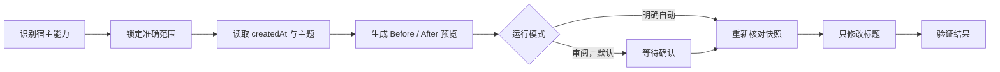

# Agent Title Renamer Skill

[English (default)](README.md) | **简体中文**

[](https://agentskills.io)
[](https://openai.com/codex/)
[](LICENSE)
[](https://github.com/BrownieCoder/agent-title-renamer-skill/stargazers)

把杂乱的 AI Agent 会话历史，整理成简短、准确、可搜索的标题。

一套可移植的命名规则，适用于 Codex、Claude Code 和其他兼容 Agent Skills 的工具。默认先预览，并始终守住一条边界：**可以修改会话标题，绝不修改项目或工作区名称。**

> Skill 指令可以跨工具复用；能否自动访问历史并执行改名，取决于各个宿主提供的工具。具体支持程度请参阅[兼容性](#兼容性)。

[查看 10 条 Demo](#一眼看懂变化) · [安装](#安装) · [兼容性](#兼容性) · [自动化](docs/automation.zh-CN.md)

## 一眼看懂变化

默认格式：`MMDD｜TYPE｜Topic`

下面是一份完整的 10 条预览。此时还没有修改任何标题。

| Before | After |
| --- | --- |
| 修复图片上传崩溃 | 0818｜修复｜图片上传崩溃 |
| 加快搜索索引 | 0820｜优化｜搜索索引 |
| 增加批量导出 | 0822｜功能｜批量导出 |
| 编写 API 鉴权文档 | 0824｜文档｜API 鉴权 |
| 探索离线同步 | 0826｜探索｜离线同步 |
| 准备 v1.2 发布 | 0828｜发布｜v1.2 发布 |
| 研究向量数据库选型 | 0830｜研究｜向量数据库选型 |
| 讨论界面对齐方案 | 0901｜设计｜界面对齐检查 |
| 修复超时后的登录跳转 | 0902｜修复｜登录跳转 |
| 优化批次文字显示 | 0903｜优化｜批次文字显示 |

完整预览正确时，在同一个会话中明确回复确认即可，例如「确认」。Agent 会重新核对这份快照，只修改标题，并逐项验证结果。

| Before | After | Result |
| --- | --- | --- |
| 修复图片上传崩溃 | 0818｜修复｜图片上传崩溃 | 已重命名 |
| 研究向量数据库选型 | 0830｜研究｜向量数据库选型 | 已重命名 |
| 优化批次文字显示 | 0903｜优化｜批次文字显示 | 已重命名 |

如果使用英文提示词调用，TYPE 将统一使用英文代码：

| Before | After |
| --- | --- |
| Improve batch text display | 0903｜OPT｜Batch text display |
| Fix timeout login redirect | 0902｜FIX｜Login redirect |
| Research vector database options | 0830｜RES｜Vector database options |

同一次运行只使用一种 TYPE 语言，绝不会把 `OPT` 和 `优化` 混在同一份预览里。

## 为什么值得用

- **更快找到旧会话。** 日期、意图和主题在侧边栏里一眼可见。
- **默认先看再改。** 审阅模式会先生成完整预览。
- **跨 Agent 复用。** Skill 遵循开放的 `SKILL.md` 格式。
- **自动化仍由你控制。** 只有明确要求时才会进入自动模式。
- **不碰内部存储。** 不直接修改未公开的数据库或会话记录文件。

## 兼容性

Agent Skills 标准定义的是指令如何打包，并没有定义通用的会话管理 API。

| 宿主 | 当前版本可以做什么 |
| --- | --- |
| 提供任务管理工具的 Codex | 完整批量流程：列出、读取、预览、改名和验证。 |
| 仅安装 Skill 的 Claude Code | 复用命名规则并生成预览；当前会话可使用 Claude Code 原生 `/rename` 应用建议标题，但不承诺自动批量修改全部历史。 |
| 其他 Agent Skills 客户端 | 命名规则可以复用；预览和执行能力会根据宿主公开的标题工具自动降级。 |

当前仓库没有附带并测试 Claude Agent SDK 适配器，因此不支持自动批量修改全部 Claude 历史。

## 安装

### Codex

告诉 Codex：

```text
$skill-installer 从 https://github.com/BrownieCoder/agent-title-renamer-skill/tree/main/skills/agent-title-renamer 安装这个 Skill。
```

然后显式调用：

```text
$agent-title-renamer 预览当前项目中会话的规范化标题。
```

### Claude Code

克隆仓库，然后把 `skills/agent-title-renamer` 复制到以下任一位置：

```text
~/.claude/skills/agent-title-renamer          # 个人级
.claude/skills/agent-title-renamer            # 项目级
```

调用方式：

```text
/agent-title-renamer 为当前会话预览一个规范化标题。
```

Claude Code 可以用 `/rename <标题>` 修改当前会话。本 Skill 不会直接编辑 Claude 的内部 JSONL 文件。

如果宿主没有提供可靠的会话创建时间，Skill 不会编造 `MMDD`；它会保留原标题，或只提供不带日期的命名建议。

### 其他兼容 Agent

把 `skills/agent-title-renamer` 目录复制到该宿主的 Agent Skills 目录。不同产品的安装路径和调用语法可能不同。

安装只会让 Agent 可以使用这个 Skill，不会自行扫描会话、修改标题或创建自动化。

仓库名和展示名保留 **Skill**，方便理解和搜索；调用名则保持简短：`agent-title-renamer`。

### 从 Codex 专用版升级

先安装 `agent-title-renamer`，把保存提示词中的 `$codex-task-title-renamer` 改为 `$agent-title-renamer`，完成一次预览测试后再移除旧 Skill 目录。GitHub 仓库重定向不会自动转换 Skill 调用名。

## 工作流程



Skill 会根据宿主能力选择可用的流程：

1. **完整流程：** 宿主可以列出、读取和重命名带标题的条目。
2. **当前条目流程：** 宿主只能访问当前会话。
3. **仅预览流程：** 宿主不能修改标题；Skill 只给出准确建议或原生命令，不会声称已经改名。

## 命名规则

- 日期只取 `createdAt`，绝不使用 `updatedAt`。
- 用户明确指定的标题时区优先；否则依次使用自动化时区、宿主配置的本地时区。
- Topic 概括会话实际内容，不重复项目或工作区名称。
- 无法判断主题时保留原标题，不猜测。
- 标题保持简短，适合在侧边栏快速浏览。
- 只修改标题；内容、归属、顺序、置顶和归档状态全部保持不变。

| 英文代码 | 中文标签 | 含义 |
| --- | --- | --- |
| FEA | 功能 | Feature |
| DES | 设计 | Design |
| FIX | 修复 | Bug fix |
| OPT | 优化 | Optimization |
| REL | 发布 | Release |
| EXP | 探索 | Exploration |
| DOC | 文档 | Documentation |
| RES | 研究 | Research |

## 审阅模式与自动模式

审阅模式（review）是默认模式：先预览，再确认当前这份快照。

自动模式（automatic）必须显式开启。请在请求或保存的自动化提示词中写明「自动执行」「无人值守」或「无需确认」。这份权限只对本次运行和指定范围有效，不会悄悄变成全局设置。

如果需要定期整理，请参阅[自动化教程](docs/automation.zh-CN.md)。里面同时提供审阅版和明确授权的自动版模板，并让用户自行选择运行时间与时区。

## 设计边界

这是一个标题治理 Skill，不是数据库迁移工具。它只使用宿主公开的能力。如果宿主无法提供稳定条目标识、可靠的 `createdAt`、完整的目标范围或“只改标题”的能力，Skill 会停止，或降级为仅预览模式。

宿主能力契约见 [`references/host-contract.md`](skills/agent-title-renamer/references/host-contract.md)。

## 文档与依据

- [自动化教程](docs/automation.zh-CN.md)
- [验收场景](tests/acceptance.md)
- [Agent Skills 规范](https://agentskills.io/specification)
- [Claude Code Skills](https://code.claude.com/docs/en/slash-commands) 与[会话命名](https://code.claude.com/docs/en/sessions)
- [Claude Agent SDK 会话 API](https://code.claude.com/docs/en/agent-sdk/python)
- [Codex App Server](https://learn.chatgpt.com/docs/app-server)

## 支持这个项目

如果整洁的会话历史帮你节省了时间，欢迎给[仓库点一个 Star](https://github.com/BrownieCoder/agent-title-renamer-skill)，让更多 Agent 用户发现它。遇到边界情况，或想贡献新的宿主适配器？欢迎[提交 Issue](https://github.com/BrownieCoder/agent-title-renamer-skill/issues)。

## License

[MIT](LICENSE)

这是一个独立的社区项目，并非 OpenAI 或 Anthropic 官方产品。
