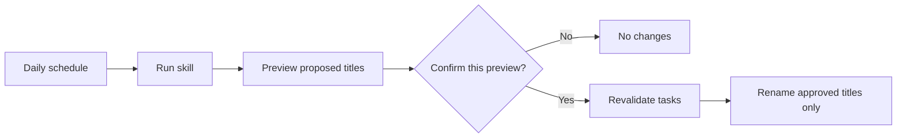

# Daily scheduling guide

[English](scheduler.md) | [简体中文](scheduler.zh-CN.md)

Use a Codex scheduled task to generate a fresh title preview every day. The recommended setup keeps the skill's approval gate: the scheduled run prepares the preview, and you decide whether to apply it.

## Recommended workflow



This is intentionally a daily **review**, not unattended daily renaming.

| Setup | What happens | Included? |
|---|---|---|
| Daily review | Codex generates a preview; you confirm before any rename | Yes — recommended |
| Unattended apply | A scheduler renames tasks without a fresh confirmation | No — this would bypass the skill's core safety rule |

## Before you start

1. Install `codex-task-title-renamer`.
2. Create or open one dedicated task inside the Codex project you want to organize. A title such as `Title housekeeping` works well.
3. Test the skill manually once and verify that its preview covers the intended project.

Keep the scheduled workflow attached to that same dedicated task. This preserves the project scope and gives you one place to review and confirm each run. The management task itself is excluded from renaming by default.

## Create the daily schedule

Paste this into the dedicated task:

```text
Create a daily scheduled task attached to this current Codex task. Before creating it, ask me what time and timezone I want to use.

On each run:
- Explicitly use $codex-task-title-renamer.
- Inspect only eligible tasks in the Codex project assigned to this task.
- Generate the skill's complete Before/After preview and make no changes yet.
- End the scheduled run immediately after the preview. Do not rename anything during the scheduled run.
- Only after I later reply `Confirm` in this same task may you revalidate and apply the latest preview.
- Never reuse confirmation from an earlier run.
- Change only the titles in the confirmed snapshot, then verify and report the results.
```

Codex will ask you to choose the daily run time and timezone before creating the schedule.

You choose the schedule's run time and timezone; regardless of that choice, each title's `MMDD` is always derived from `createdAt` in `Asia/Shanghai`.

## Review the first run

The scheduled run should produce only a preview like this:

| Before | After |
|---|---|
| Update API setup guide | 0818｜DOC｜API setup guide |
| Add CSV export for reports | 0820｜FEA｜CSV report export |
| Review dashboard layout options | 0822｜DES｜Dashboard layout |
| Explore offline sync feasibility | 0824｜EXP｜Offline sync |
| Reduce image loading time | 0826｜OPT｜Image loading |
| Push the v1.2 release to GitHub | 0828｜REL｜v1.2 |
| Research vector database options | 0830｜RES｜Vector database options |
| Add keyboard shortcuts | 0901｜FEA｜Keyboard shortcuts |
| Fix login redirect after timeout | 0902｜FIX｜Login redirect |
| Improve batch text display | 0903｜OPT｜Batch text display |

If the full preview looks right, reply `Confirm` in the same task.

Codex then revalidates the approved snapshot, renames only unchanged matching tasks, and reports the result. If the preview is wrong, describe the correction instead of confirming; the skill will generate a revised complete preview.

## Verify the schedule

After creation, check that:

- the schedule is active and shows the intended local time;
- it is attached to the dedicated task in the target project;
- the saved prompt explicitly names `$codex-task-title-renamer`;
- the first run stops after the preview;
- a confirmation from one run is not applied to the next run.

Project-scoped scheduled tasks need the Codex desktop app running, the computer awake, and the local project available when the schedule fires. Test the prompt manually before relying on the schedule.

## Change or stop it

In the same task, ask Codex in plain language, for example:

```text
Change this title-review schedule to every weekday at 6:30 PM and keep its current timezone.
```

```text
Pause the daily title-review schedule.
```

```text
Delete the daily title-review schedule.
```

For product details, see OpenAI's [Scheduled tasks documentation](https://learn.chatgpt.com/docs/automations).
