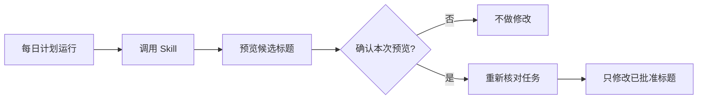

# 每日计划任务教程

[English](scheduler.md) | [简体中文](scheduler.zh-CN.md)

你可以用 Codex 计划任务每天生成一份新的标题预览。推荐配置会保留 Skill 的确认门槛：计划任务负责准备预览，由你决定是否执行。

## 推荐流程



这里每天只做一次**审阅**，不会在无人确认时自动改名。

| 配置 | 实际行为 | 是否包含 |
|---|---|---|
| 每日审阅 | Codex 自动生成预览，你确认后才改名 | 是，推荐 |
| 无人值守执行 | 计划任务不经本次确认直接改名 | 否，这会绕过 Skill 的核心安全规则 |

## 开始前

1. 安装 `codex-task-title-renamer`。
2. 在需要整理的 Codex 项目中，新建或打开一个专门用于管理标题的任务，例如“标题日常整理”。
3. 先手动调用一次 Skill，核对预览对应的是目标项目。

让计划任务始终附着在这个专用任务上。这样每次都只会处理同一个项目，预览和确认也都集中在同一个地方。默认情况下，这个管理任务本身不会被改名。

## 创建每日计划

把下面这段话粘贴到专用任务中：

```text
请为当前 Codex 任务创建一个每日计划。创建前，先询问我希望每天几点运行，以及使用哪个时区。

每次运行时：
- 显式调用 $codex-task-title-renamer。
- 只检查当前任务所属 Codex 项目中符合条件的任务。
- 只生成 Skill 规定的完整 Before/After 预览，此时不做任何修改。
- 输出预览后立即结束本次计划运行；本次计划运行不得修改标题。
- 只有我随后在同一个任务中回复「确认」，才可以重新核对并执行最新预览。
- 绝不沿用以前某次运行的确认。
- 只修改已确认快照中的标题，然后验证并报告结果。
```

Codex 会在创建计划前，让你自行选择每天的运行时间和时区。

计划几点运行、采用哪个时区由你决定；标题里的 `MMDD` 始终取 `createdAt` 转换到 `Asia/Shanghai` 后的日期。

## 核对第一次运行

计划运行后，应该只出现类似下面的预览：

| Before | After |
|---|---|
| 更新 API 配置指南 | 0818｜文档｜API配置指南 |
| 为报表添加 CSV 导出 | 0820｜功能｜报表CSV导出 |
| 讨论仪表盘布局方案 | 0822｜设计｜仪表盘布局 |
| 探索离线同步可行性 | 0824｜探索｜离线同步 |
| 优化图片加载速度 | 0826｜优化｜图片加载 |
| 把 v1.2 发布到 GitHub | 0828｜发布｜v1.2 |
| 研究向量数据库选型 | 0830｜研究｜向量数据库选型 |
| 添加键盘快捷键 | 0901｜功能｜键盘快捷键 |
| 修复超时后的登录跳转 | 0902｜修复｜登录跳转 |
| 优化批次文字显示 | 0903｜优化｜批次文字显示 |

如果完整预览没有问题，在同一个任务中回复「确认」即可。

Codex 随后会重新核对已批准的快照，只修改仍然匹配且没有发生变化的任务，再报告结果。如果预览不正确，请直接描述需要调整的地方，不要确认；Skill 会重新生成一份完整预览。

## 验证计划配置

创建完成后，请检查：

- 计划处于启用状态，并显示正确的本地运行时间；
- 计划附着在目标项目的专用任务上；
- 保存的提示词明确包含 `$codex-task-title-renamer`；
- 第一次运行确实停在预览阶段；
- 某次运行的确认不会被下一次运行继承。

项目范围内的本地计划任务运行时，需要保持电脑唤醒、Codex 桌面应用正在运行，并且本地项目可以访问。正式依赖计划任务之前，建议先手动测试一次提示词。

## 修改、暂停或删除

在同一个任务中直接用自然语言告诉 Codex，例如：

```text
把标题审阅计划改为每个工作日下午 6:30，沿用当前设置的时区。
```

```text
暂停每日标题审阅计划。
```

```text
删除每日标题审阅计划。
```

产品行为与限制请参阅 OpenAI 官方的[计划任务文档](https://learn.chatgpt.com/zh-Hans/docs/automations)。
